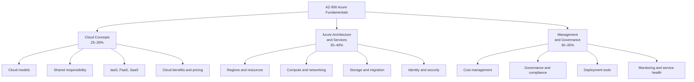
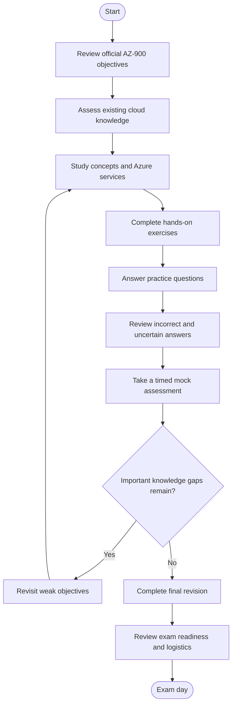
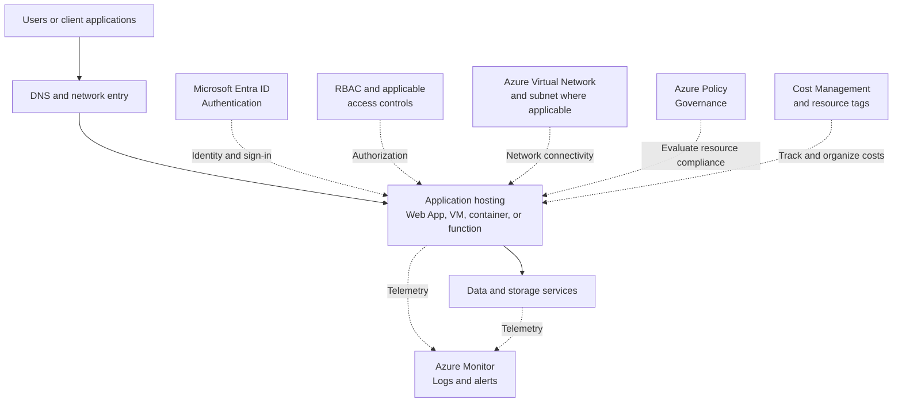
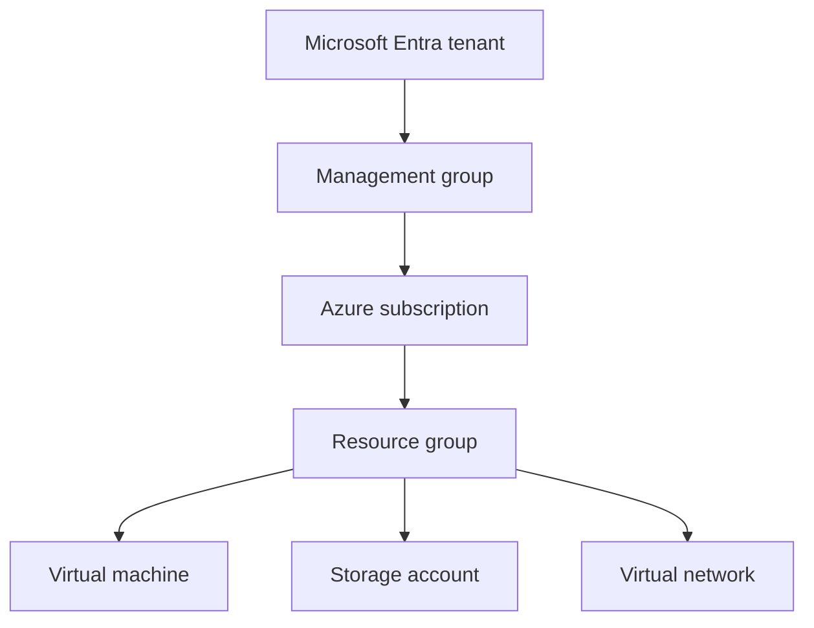
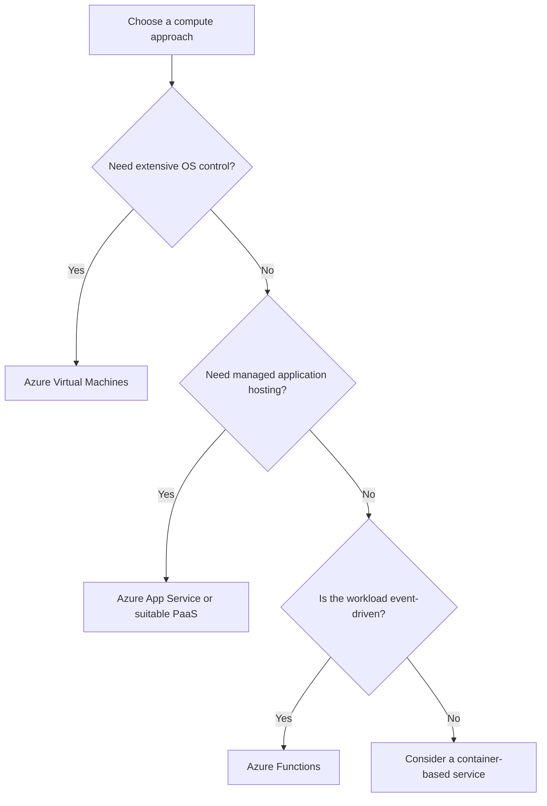
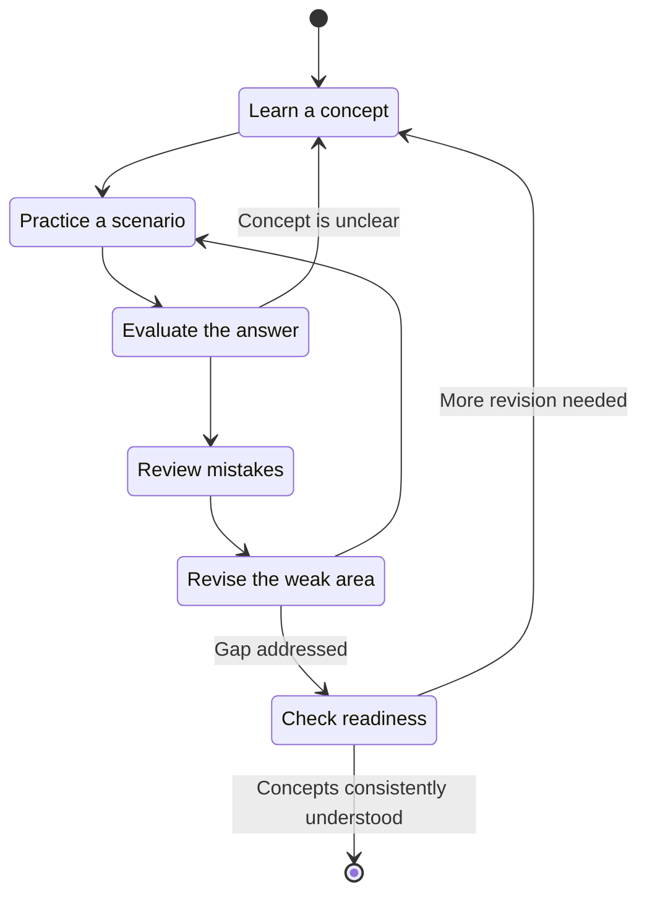
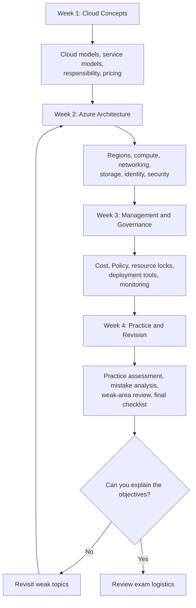

# Microsoft AZ-900: Azure Fundamentals Study Guide

A practical study guide for the **Microsoft Azure Fundamentals (AZ-900)** certification, covering cloud computing, Azure architecture, core services, identity and security, governance, monitoring, and cost management.

This repository combines exam objectives, Mermaid diagrams, hands-on learning exercises, original practice questions, and a structured study roadmap to help learners build a solid foundation in Microsoft Azure.

**Official resources:** [AZ-900 certification](https://learn.microsoft.com/en-us/credentials/certifications/azure-fundamentals/) · [Official study guide](https://learn.microsoft.com/en-us/credentials/certifications/resources/study-guides/az-900)

---

## Table of Contents

- [Overview](#overview)
- [About the AZ-900 Certification](#about-the-az-900-certification)
- [Who Should Prepare for AZ-900?](#who-should-prepare-for-az-900)
- [Exam Details](#exam-details)
- [Official AZ-900 Exam Objectives](#official-az-900-exam-objectives)
- [Exam Domain Weightings](#exam-domain-weightings)
- [Azure Skills Map](#azure-skills-map)
- [AZ-900 Preparation Flowchart](#az-900-preparation-flowchart)
- [Azure Architecture and Service Relationships](#azure-architecture-and-service-relationships)
- [Azure Resource Organization](#azure-resource-organization)
- [Cloud Service Models Compared](#cloud-service-models-compared)
- [Circular Study and Revision Cycle](#circular-study-and-revision-cycle)
- [Step-by-Step AZ-900 Preparation](#step-by-step-az-900-preparation)
- [Four-Week Study Roadmap](#four-week-study-roadmap)
- [Practice Questions](#practice-questions)
- [Hands-On Labs and Projects](#hands-on-labs-and-projects)
- [Common Preparation Mistakes](#common-preparation-mistakes)
- [Career Relevance](#career-relevance)
- [Frequently Asked Questions](#frequently-asked-questions)
- [Official and Additional Learning Resources](#official-and-additional-learning-resources)
- [About CertsGate](#about-certsgate)

---

## Overview

Cloud computing provides computing resources such as servers, storage, networking, and application platforms over a network. Microsoft Azure is Microsoft's cloud platform, offering services for hosting applications, storing data, managing identities, protecting resources, and monitoring workloads.

AZ-900 focuses on understanding these services and the concepts behind them. It is a fundamentals-level certification, so the goal is to recognize what Azure services do, understand common use cases, and distinguish between available approaches rather than master advanced implementation.

This **AZ-900 study guide** organizes the published objectives into manageable learning areas. It is useful for beginners, IT professionals exploring cloud technology, and learners preparing to continue toward role-based Azure certifications.

### What this repository covers

- Cloud computing models and the shared responsibility model.
- Azure regions, availability zones, subscriptions, and resource groups.
- Compute, networking, storage, and migration services.
- Microsoft Entra ID, authentication, RBAC, and security concepts.
- Azure Policy, resource locks, governance, and compliance.
- Azure monitoring, service health, and cost management.
- Practice questions, revision strategies, and practical exercises.

For the authoritative list of exam skills, use the [official Microsoft AZ-900 study guide](https://learn.microsoft.com/en-us/credentials/certifications/resources/study-guides/az-900).

## About the AZ-900 Certification

**Microsoft Certified: Azure Fundamentals** validates foundational knowledge of cloud concepts and Microsoft Azure services, including Azure architecture, management, and governance.

The certification is a common starting point for people who want to learn cloud computing before moving into more specialized roles. It can also help experienced IT professionals organize and demonstrate their understanding of Azure fundamentals.

You do not need to be an Azure administrator or an expert programmer to begin studying. However, familiarity with IT infrastructure, databases, software development, or general computing concepts can make the material easier to understand.

Official certification page: [Microsoft Certified: Azure Fundamentals](https://learn.microsoft.com/en-us/credentials/certifications/azure-fundamentals/)

## Who Should Prepare for AZ-900?

This certification may be useful for:

- **Beginners:** Learners building their first cloud computing foundation.
- **IT support professionals:** People who want to understand Azure services and terminology.
- **System administrators:** Professionals exploring cloud infrastructure and management.
- **Developers:** People who want to understand Azure hosting and application services.
- **Database professionals:** Learners exploring Azure storage and cloud data services.
- **Students and career changers:** People preparing for further study in cloud computing.
- **Technical decision-makers:** Professionals who need foundational knowledge of cloud models, governance, and cost.

The exam emphasizes understanding and service selection. Hands-on exploration is helpful, but advanced scripting or production-level Azure administration is not the central purpose of AZ-900.

## Exam Details

| Item | Details |
|---|---|
| Exam code | AZ-900 |
| Certification | Microsoft Certified: Azure Fundamentals |
| Provider | Microsoft |
| Level | Beginner |
| Exam duration | 45 minutes |
| Passing score | 700 or greater |
| Exam delivery | Proctored; interactive components may be included |
| Question count | Not specified here; verify current official information |
| Exam price | Varies by country or region |
| Recommended background | Familiarity with an IT area such as infrastructure, databases, or software development |
| Official preparation | Microsoft Learn study guide, learning paths, and practice assessment |

Microsoft's listed 45 minutes refers to the assessment duration. Review the official exam scheduling information for details about the full appointment and exam experience.

Check the [official certification page](https://learn.microsoft.com/en-us/credentials/certifications/azure-fundamentals/) for current exam languages, scheduling, policies, and pricing. Microsoft identifies a score of 700 or greater as the passing threshold in the [AZ-900 study guide](https://learn.microsoft.com/en-us/credentials/certifications/resources/study-guides/az-900).

---

## Official AZ-900 Exam Objectives

The current Microsoft study guide organizes AZ-900 into three main skill areas. The percentages below are the official published ranges, not exact allocations of questions.

### 1. Describe Cloud Concepts — 25–30%

Understand how cloud computing works and why organizations use it.

Topics include:

- Defining cloud computing.
- Understanding the shared responsibility model.
- Comparing public, private, and hybrid cloud.
- Identifying appropriate use cases for cloud models.
- Understanding consumption-based pricing.
- Comparing cloud pricing models.
- Describing serverless computing.
- Understanding high availability, scalability, reliability, and predictability.
- Recognizing cloud security, governance, and manageability benefits.
- Comparing Infrastructure as a Service (IaaS), Platform as a Service (PaaS), and Software as a Service (SaaS).

**Study objective:** Explain the differences between cloud models and service types, including which responsibilities remain with the customer.

### 2. Describe Azure Architecture and Services — 35–40%

Understand Azure's main architectural components and the services available for common workloads.

#### Core architectural components

- Azure regions, region pairs, and sovereign regions.
- Availability zones and Azure datacenters.
- Azure resources and resource groups.
- Subscriptions and management groups.
- The hierarchy connecting management groups, subscriptions, and resource groups.

#### Compute and networking

- Containers, virtual machines, and functions.
- Azure Virtual Machines, Virtual Machine Scale Sets, availability sets, and Azure Virtual Desktop.
- Resources required to run virtual machines.
- Web apps and application hosting options.
- Virtual networks and subnets.
- Virtual network peering and Azure DNS.
- Azure VPN Gateway and ExpressRoute.
- Public and private endpoints.

#### Storage and migration

- Azure Storage services and storage account options.
- Blob, file, queue, and table storage concepts.
- Storage tiers and redundancy options.
- AzCopy, Azure Storage Explorer, and Azure File Sync.
- Azure Migrate and Azure Data Box.

#### Identity, access, and security

- Microsoft Entra ID and Microsoft Entra Domain Services.
- Single sign-on (SSO), multifactor authentication (MFA), and passwordless authentication.
- External identities and Conditional Access.
- Azure role-based access control (RBAC).
- Zero Trust and defense in depth.
- Microsoft Defender for Cloud.

**Study objective:** Match services to their purpose and distinguish between similar technologies based on their use cases.

### 3. Describe Azure Management and Governance — 30–35%

Understand how Azure resources are controlled, monitored, governed, and managed for cost.

#### Cost management

- Factors affecting Azure costs.
- Azure Pricing Calculator.
- Cost Management capabilities.
- Resource tags and their uses.

#### Governance and compliance

- Microsoft Purview.
- Azure Policy.
- Resource locks.

#### Resource management and deployment

- Azure portal.
- Azure Cloud Shell.
- Azure CLI and Azure PowerShell.
- Azure Arc.
- Infrastructure as code (IaC).
- Azure Resource Manager (ARM) and ARM templates.

#### Monitoring

- Azure Advisor.
- Azure Service Health.
- Azure Monitor.
- Log Analytics.
- Azure Monitor alerts.
- Application Insights.

**Study objective:** Understand how Azure resources can be deployed, organized, monitored, governed, and managed for cost.

For the complete list of sub-objectives, consult the [official AZ-900 skills measured](https://learn.microsoft.com/en-us/credentials/certifications/resources/study-guides/az-900).

## Exam Domain Weightings

Microsoft publishes percentage ranges for the three AZ-900 skill areas.

| Official skill area | Published weight |
|---|---:|
| Describe cloud concepts | 25–30% |
| Describe Azure architecture and services | 35–40% |
| Describe Azure management and governance | 30–35% |

**How to use these ranges:** Give extra revision attention to Azure architecture and services because it has the highest published range. Do not ignore the other domains, and do not assume the exam uses a fixed number of questions per topic.

The official values are ranges, not single percentages. This guide therefore does not convert them into exact values for a pie or bar chart, since doing so would imply an unsupported allocation. The following conceptual map shows how the skills relate without introducing invented metrics.

## Azure Skills Map

The domain weights shown in this diagram are the official ranges from Microsoft's current study guide. The subtopics are grouped for learning convenience.

## AZ-900 Preparation Flowchart

Use this preparation process to connect official objectives with study, practice, and revision. If a practice test exposes a gap, revisit the relevant material before moving on.

## Azure Architecture and Service Relationships

Azure offers services for application hosting, networking, storage, identity, and monitoring. This conceptual diagram illustrates how these service categories can work together in a typical cloud-hosted application.

It is a learning diagram, not a prescribed architecture or a requirement that every Azure application use every service shown.

### What to Learn from This Architecture

- **Compute:** Choose a hosting option based on the application and the level of control required.
- **Networking:** Understand how virtual networks, subnets, DNS, and connectivity options relate to workloads.
- **Storage:** Select an appropriate storage service for the data type and access pattern.
- **Identity:** Authentication establishes who is signing in; authorization determines what they can access.
- **Governance:** Azure Policy can evaluate resources against organizational rules.
- **Monitoring:** Azure Monitor supports telemetry, logs, and alerts for supported resources.

AZ-900 focuses on understanding these relationships. You should be able to explain what a service does and when it may be appropriate.

## Azure Resource Organization

Azure resource hierarchy is a core concept because it determines how resources are organized and how management and governance can be applied.

This diagram is simplified: a tenant can have a hierarchy of management groups and multiple subscriptions, while resources are organized into resource groups within subscriptions. Resource groups are not necessarily a network boundary or a security boundary.

Remember the roles of the main components:

| Component | Purpose |
|---|---|
| Management group | Organizes subscriptions for governance at scale |
| Subscription | Provides a management, access, and billing boundary |
| Resource group | Organizes related Azure resources |
| Resource | An individual Azure service instance, such as a VM or storage account |

## Cloud Service Models Compared

A frequent AZ-900 learning task is identifying which cloud service model best fits a scenario.

| Model | What the provider supplies | Customer responsibility in general | Example use |
|---|---|---|---|
| IaaS | Infrastructure such as virtualized compute and networking | More control over operating systems, configuration, and applications | Running a VM that requires operating-system control |
| PaaS | A managed platform for deploying applications | Application code, data, and relevant configuration | Hosting an application without managing the underlying OS |
| SaaS | A complete software application | Using the application and managing customer-controlled data and settings | Using a cloud-based productivity application |

Actual responsibility depends on the service and deployment. Learn the shared responsibility model rather than treating the table as an absolute rule for every product.

### Choosing a Compute Option

This is a simplified decision aid. The right choice also depends on workload design, scaling, operating requirements, compatibility, and cost.

## Circular Study and Revision Cycle

AZ-900 preparation is more effective when study and assessment reinforce one another. Repeat this cycle for each objective until you can explain the concept and distinguish it from similar services.

For example, if you repeatedly confuse Azure Policy with RBAC, review the difference, create a comparison note, and answer a new scenario. Do not rely only on memorizing the wording of an earlier question.

## Step-by-Step AZ-900 Preparation

### Step 1: Start with the Official Study Guide

Open the [AZ-900 study guide](https://learn.microsoft.com/en-us/credentials/certifications/resources/study-guides/az-900) and turn each objective into a checklist.

For every topic, mark whether you can:

- Define the concept in your own words.
- Explain the problem it solves.
- Compare it with related services.
- Identify a suitable use case.
- Answer a scenario question and explain your reasoning.

This makes it easier to identify actual knowledge gaps rather than simply counting completed lessons.

### Step 2: Understand Cloud Fundamentals

Begin with cloud models, service models, shared responsibility, consumption-based pricing, and cloud benefits.

Practice comparing:

- Public, private, and hybrid cloud.
- IaaS, PaaS, and SaaS.
- Scalability and elasticity.
- High availability and reliability.
- Capital expenditure and consumption-based operational costs.
- Managed services and customer-managed infrastructure.

Focus on the differences that affect a real decision.

### Step 3: Study Azure Architecture and Services

Learn the purpose of regions, availability zones, resource groups, subscriptions, and management groups.

Then review the core service categories:

- Compute and application hosting.
- Virtual networks and connectivity.
- Storage services and redundancy.
- Identity and access.
- Security and defense in depth.

Build a simple comparison table for services that sound similar. For example, compare Azure VPN Gateway with ExpressRoute, and Azure Policy with RBAC.

### Step 4: Learn Governance, Monitoring, and Cost

Study the purpose of Azure Policy, resource locks, tags, Azure Advisor, Azure Service Health, and Azure Monitor.

Understand these distinctions:

- **Azure Policy:** Evaluates resources against rules and can support governance enforcement.
- **RBAC:** Controls what identities can do at applicable scopes.
- **Resource locks:** Help protect resources against accidental deletion or modification.
- **Azure Advisor:** Provides recommendations for supported areas such as cost, reliability, performance, operational excellence, and security.
- **Azure Service Health:** Provides information about Azure service issues and health events relevant to your services and regions.
- **Azure Monitor:** Collects and analyzes telemetry and supports alerts and monitoring workflows.

Check the official documentation for current capabilities and limitations.

### Step 5: Use Microsoft Learn and Practical Exercises

Follow Microsoft's [AZ-900 learning resources](https://learn.microsoft.com/en-us/credentials/certifications/azure-fundamentals/).

Where possible, explore the Azure portal and inspect the structure of resources, subscriptions, networking, storage, and monitoring. You do not need to deploy every service to learn the fundamentals.

If you create real Azure resources, check pricing and delete resources you no longer need. Some resources may incur charges even when you are not actively using them.

### Step 6: Practice and Analyze Mistakes

Use Microsoft's official practice assessment, along with independent practice resources if helpful.

After every question:

1. Explain why your selected answer is appropriate.
2. Explain why the alternatives are less suitable.
3. Identify the relevant AZ-900 objective.
4. Review the official documentation if your reasoning is uncertain.
5. Answer a new question on the same concept.

A question answered correctly by guessing should still be reviewed.

### Step 7: Check Exam Readiness

Before scheduling, make sure you can explain the major objectives, compare commonly confused services, and answer practice questions without relying on memorized wording.

Review the [official exam sandbox](https://aka.ms/examdemo) so you are familiar with the testing interface. Confirm the latest exam policies and appointment details through Microsoft's certification page.

## Four-Week Study Roadmap

This is a suggested study plan, not an official Microsoft schedule. Adjust the length to your experience and available time.

| Week | Focus | Suggested activities |
|---|---|---|
| 1 | Cloud concepts | Compare cloud models, service models, responsibility, and pricing |
| 2 | Azure architecture and services | Study compute, networking, storage, identity, and security |
| 3 | Management and governance | Review cost management, Policy, monitoring, deployment, and compliance |
| 4 | Assessment and revision | Practice questions, review mistakes, and revisit weak objectives |

Avoid treating the roadmap as a race. If a concept remains unclear, spend more time on it before moving on.

## Practice Questions

The following questions are original educational examples written for this repository. They are **not official Microsoft exam questions** and are not intended to predict the actual exam.

### Question 1: Cloud Service Models

A company wants to deploy an application while minimizing the need to manage the underlying operating system. Which cloud service model is generally the best fit?

A. IaaS  
B. PaaS  
C. Private cloud  
D. On-premises infrastructure

**Answer: B — PaaS**

**Explanation:** Platform as a Service provides a managed platform for application deployment. The exact responsibilities depend on the service, but it generally reduces the customer's need to manage the underlying operating system compared with IaaS.

### Question 2: Azure Resource Organization

An organization needs to organize multiple Azure subscriptions so governance can be applied at a higher level. Which component is designed for this purpose?

A. Resource group  
B. Storage account  
C. Management group  
D. Virtual network

**Answer: C — Management group**

**Explanation:** Management groups help organize subscriptions into a hierarchy so governance can be applied across multiple subscriptions.

### Question 3: Access Permissions

An administrator needs to control which actions a user can perform on Azure resources at a particular scope. Which capability is most directly relevant?

A. Azure DNS  
B. Azure RBAC  
C. Azure Data Box  
D. Azure Service Health

**Answer: B — Azure RBAC**

**Explanation:** Role-based access control assigns permissions to identities at supported scopes. The exact permissions depend on the role assignment.

### Question 4: Cost Estimation

A team wants to estimate the expected cost of a proposed Azure deployment before creating the resources. Which tool should it consider?

A. Azure Pricing Calculator  
B. Azure Service Health  
C. Microsoft Entra ID  
D. Azure Virtual Network

**Answer: A — Azure Pricing Calculator**

**Explanation:** The Pricing Calculator helps estimate costs for selected Azure services and configuration assumptions. Actual costs can vary with usage, region, and other factors.

### Question 5: Monitoring Application Performance

A developer wants to investigate application performance and related telemetry. Which Azure capability is most relevant?

A. Management groups  
B. Application Insights  
C. Resource locks  
D. Azure Data Box

**Answer: B — Application Insights**

**Explanation:** Application Insights is an application performance monitoring capability within the Azure Monitor ecosystem.

### Question 6: Cloud Responsibility

A company uses a cloud service but still needs to manage its own identities and data access. Which concept explains why some responsibilities remain with the customer?

A. Availability zones  
B. Shared responsibility model  
C. Resource redundancy  
D. Consumption-based pricing

**Answer: B — Shared responsibility model**

**Explanation:** The shared responsibility model describes how security and operational responsibilities are divided between the cloud provider and the customer. The exact division depends on the service model.

### How to Use Practice Questions

Do not stop after checking the correct answer. Write a short explanation for each option and identify the exam objective being tested. If you cannot explain why the other options are less suitable, revisit the topic before attempting another set.

## Hands-On Labs and Projects

Practical exercises make abstract cloud concepts easier to remember. Use an authorized Azure subscription, training environment, or suitable learning sandbox. Review pricing before deploying resources.

### Project 1: Map an Azure Environment

**Goal:** Understand Azure's resource hierarchy.

Tasks:

1. Review the relationship between management groups and subscriptions.
2. Explore how resource groups organize resources.
3. Identify which components represent resources and which provide organizational structure.
4. Draw a hierarchy for a hypothetical organization.
5. Explain where governance policies could be applied.

**Skills reinforced:** Azure architecture, subscriptions, resource groups, and management groups.

### Project 2: Compare Compute Services

**Goal:** Learn to choose a compute approach based on a workload.

Tasks:

1. Compare virtual machines, containers, functions, and managed application hosting.
2. Identify how much operating-system control each approach provides.
3. Compare likely operational responsibilities.
4. Select an option for a sample web application.
5. Explain why the alternatives might be less suitable.

**Skills reinforced:** Compute services and application hosting.

### Project 3: Design a Basic Virtual Network

**Goal:** Understand core networking components.

Tasks:

1. Draw a virtual network with two subnets.
2. Describe how resources could communicate within the network.
3. Compare VPN Gateway with ExpressRoute at a conceptual level.
4. Explain the purpose of DNS and private endpoints.
5. Review the relevant official networking documentation.

**Skills reinforced:** Virtual networks, subnets, DNS, connectivity, and endpoints.

### Project 4: Compare Azure Storage Options

**Goal:** Match storage services to data needs.

Tasks:

1. Compare blob, file, queue, and table storage.
2. Identify example workloads for each.
3. Review storage tiers and redundancy options.
4. Compare file transfer and migration tools.
5. Explain the trade-offs in your choices.

**Skills reinforced:** Storage, redundancy, data movement, and migration.

### Project 5: Understand Governance and Monitoring

**Goal:** Distinguish governance, access control, and monitoring.

Tasks:

1. Write a short scenario requiring an Azure resource policy.
2. Identify which requirement relates to RBAC.
3. Explain how resource locks differ from policy controls.
4. Compare Azure Advisor, Service Health, and Azure Monitor.
5. Describe how alerts and logs can support troubleshooting.

**Skills reinforced:** Governance, identity, monitoring, and cost awareness.

### Cost and Security Reminder

Hands-on practice is valuable, but Azure resources may incur charges. Use official pricing information, avoid deploying unnecessary services, protect credentials, and remove resources when you finish an exercise.

## Common Preparation Mistakes

### Memorizing Service Names Without Understanding Use Cases

AZ-900 often requires you to distinguish between services. Learn what each service does and why you would choose it.

### Confusing Similar Services

Pay special attention to concepts such as:

- RBAC versus Azure Policy.
- Azure Monitor versus Azure Service Health.
- Availability zones versus regions.
- IaaS versus PaaS.
- VPN Gateway versus ExpressRoute.
- Resource groups versus subscriptions.
- Authentication versus authorization.

### Ignoring the Published Weight Ranges

Use the official skill ranges to help allocate study time, but do not neglect a domain simply because it has a smaller range.

### Using Practice Scores as Proof of Readiness

A practice assessment is a diagnostic tool. Analyze incorrect answers, uncertain answers, and lucky guesses.

### Relying on Outdated Study Materials

Azure services and exam objectives evolve. Verify the current blueprint and use current Microsoft documentation for product behavior.

### Skipping Practical Exploration

Even though AZ-900 is a fundamentals exam, exploring the portal and service documentation can make concepts easier to understand and compare.

### Forgetting Cost Implications

When practicing in a real Azure environment, remember that resource usage can create charges. Check current pricing and clean up unused resources.

## Career Relevance

AZ-900 provides a foundation for understanding cloud computing and Microsoft Azure. The knowledge can support further learning in areas such as Azure administration, cloud development, data services, security, and governance.

Relevant foundational skills include:

- Understanding cloud service and deployment models.
- Recognizing Azure compute, networking, and storage services.
- Understanding identity, access control, and security concepts.
- Explaining resource organization and governance.
- Identifying monitoring and cost management tools.

The certification can demonstrate foundational knowledge, but it does not replace hands-on experience or the deeper technical skills required for advanced roles. Its relevance depends on the goals of the learner and the requirements of the role.

## Frequently Asked Questions

### What is AZ-900?

AZ-900 is the Microsoft Azure Fundamentals exam. It assesses foundational knowledge of cloud concepts, Azure architecture and services, and Azure management and governance.

### What is the passing score for AZ-900?

Microsoft's official study guide states that a score of **700 or greater** is required to pass. Check the official guide for current scoring information.

### How long is the AZ-900 exam?

Microsoft's certification page lists 45 minutes for the assessment. Check the current exam appointment information for details about the overall testing experience.

### How many questions are on the AZ-900 exam?

This repository does not claim a fixed question count. Check Microsoft's current exam information rather than relying on unverified numbers from third-party websites.

### Is AZ-900 suitable for beginners?

Yes. It is a beginner-level certification designed to demonstrate foundational knowledge of cloud computing and Azure. Familiarity with general IT concepts can be helpful, but advanced Azure administration is not the goal.

### Do I need to know programming for AZ-900?

Advanced programming is not the central focus of the exam. The objectives emphasize cloud concepts, service capabilities, architecture, governance, and management tools.

### What are the main AZ-900 exam domains?

The official study guide lists three domains:

- Describe cloud concepts: 25–30%.
- Describe Azure architecture and services: 35–40%.
- Describe Azure management and governance: 30–35%.

### Are the practice questions in this repository official?

No. They are original learning examples intended to reinforce relevant concepts. They are not represented as actual, leaked, or official Microsoft exam questions.

### Where should I start studying?

Begin with the official [AZ-900 study guide](https://learn.microsoft.com/en-us/credentials/certifications/resources/study-guides/az-900), then follow Microsoft's learning resources and practice assessment. Add practical exercises and independent study resources where useful.

### Can CertsGate replace Microsoft Learn?

CertsGate can be an independent supplementary resource, but it should not replace Microsoft's official exam objectives and technical documentation. Use practice materials to identify gaps and verify concepts against authoritative sources.

## Official and Additional Learning Resources

Use official Microsoft resources for current exam objectives, service definitions, and certification requirements.

### Microsoft Certification and Training

- [Microsoft Certified: Azure Fundamentals](https://learn.microsoft.com/en-us/credentials/certifications/azure-fundamentals/) — certification details, exam scheduling, and practice assessment.
- [AZ-900 Official Study Guide](https://learn.microsoft.com/en-us/credentials/certifications/resources/study-guides/az-900) — skills measured, exam updates, and recommended resources.
- [Introduction to Cloud Infrastructure — AZ-900T00-A](https://learn.microsoft.com/en-us/training/courses/az-900t00) — Microsoft training course covering cloud concepts, core Azure services, and management and governance.
- [Microsoft Learn](https://learn.microsoft.com/) — self-paced learning modules and technical documentation.
- [Exam Sandbox](https://aka.ms/examdemo) — experience the exam interface before test day.

### Azure Technical Documentation

- [Azure Documentation](https://learn.microsoft.com/en-us/azure/) — official technical documentation for Azure services.
- [Azure Architecture Center](https://learn.microsoft.com/en-us/azure/architecture/) — architecture guidance and design patterns.
- [Azure Pricing Calculator](https://azure.microsoft.com/en-us/pricing/calculator/) — estimate costs for selected Azure services.
- [Azure Cost Management](https://learn.microsoft.com/en-us/azure/cost-management-billing/) — cost analysis and management guidance.
- [Azure Well-Architected Framework](https://learn.microsoft.com/en-us/azure/well-architected/) — guidance on designing and evaluating cloud workloads.

## About CertsGate

[CertsGate](https://certsgate.com/) is an independent IT certification preparation website. Learners preparing for AZ-900 can explore relevant study materials and practice resources as an additional way to review concepts and identify topics that need further attention.

A balanced AZ-900 preparation plan combines:

1. The official Microsoft exam objectives.
2. Microsoft Learn and Azure technical documentation.
3. Conceptual understanding and practical exploration.
4. Practice questions and mock assessments.
5. Review of mistakes and focused revision.
